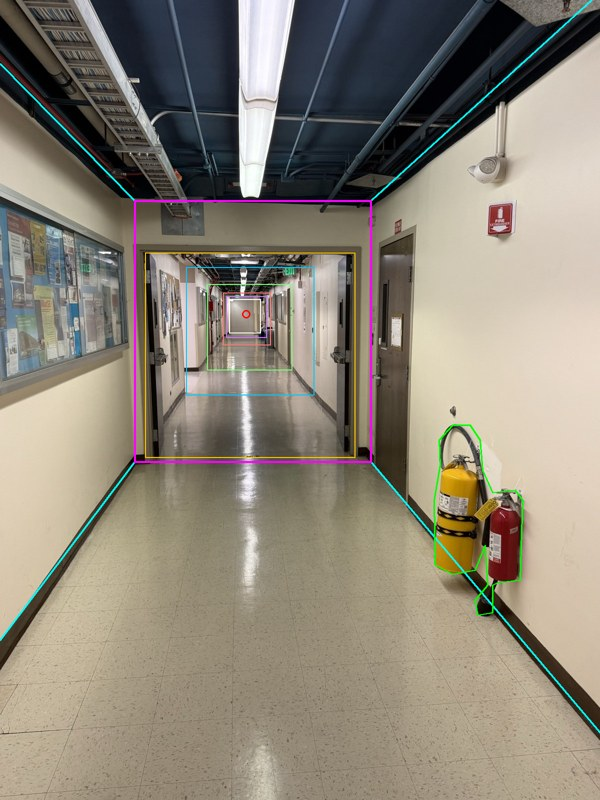
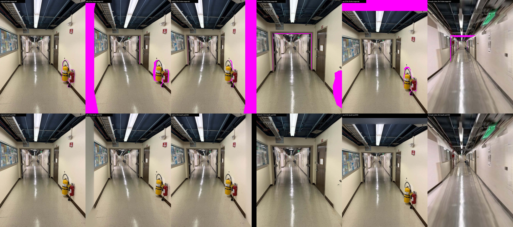
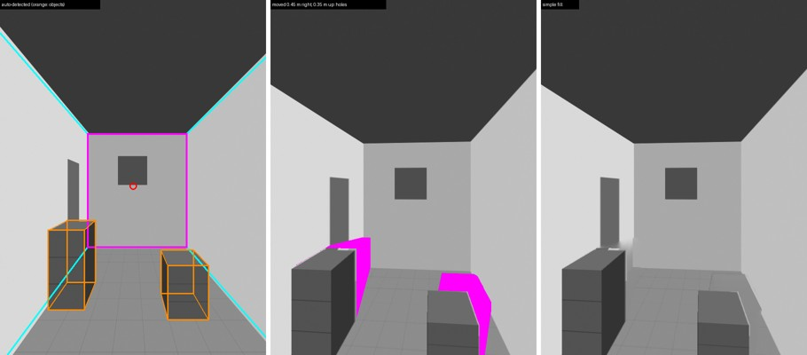

# StepInside

CS180 final project: turn a single interior photograph into a scene you can step into, moving a little sideways or forward and seeing objects shift against the walls behind them.

The starting point is **Tour Into the Picture** (TIP; Horry, Anjyo & Arai, SIGGRAPH 1997). The room is a textured box (back wall, floor, ceiling, left and right walls), and foreground objects are flat cutouts standing at their estimated depth. When the camera moves, it reveals regions the photo never saw. The project's research question is how to fill those: later we will add diffusion inpainting on the rectified wall and floor textures and compare it against inpainting the original photo directly.

**Status:** TIP baseline working on the hallway scene: a chain of 7 boxes runs from the camera through the doorway to the corridor's end wall. Holes are shown, and a simple push-pull fill is available. Automatic annotation detects the vanishing point, the back wall, the deeper boxes down the corridor and room-aligned furniture (cabinets, desks) as 3D boxes. An interactive editor lets you adjust the result. Diffusion completion is not started.

| Hand annotation (7 boxes) | Automatic annotation (3 boxes) | Novel views (top: holes in magenta, bottom: push-pull fill) |
|---|---|---|
|  |  |  |

Camera sweep with the simple fill: [`outputs/hallway/sweep.gif`](outputs/hallway/sweep.gif)

**Rectified faces.** Each face of the room is perspective-corrected and unfolded at true scale, with holes (no photo data) in magenta. The bulletin board and door become clean rectangles, and the missing regions become simple strips along each face's near edge. That is the case for completing holes in this rectified space rather than in the photo (`python scripts/face_textures.py data/annotations/hallway.json`):


**Room-aligned objects.** Furniture that sits square to the room (cabinets, desks, shelves, beds) is detected automatically and becomes a solid box, not a flat cutout. Moving the camera shows its side and top from a new angle and reveals the floor and wall it hid, as holes (magenta). Shown on a synthetic test room with known geometry. The poster and door are correctly *not* detected (`python scripts/synthetic_demo.py`, then the usual pipeline):



## Quick start

```bash
pip install -r requirements.txt          # numpy, pillow, matplotlib

# 1. Build the scene (geometry + per-plane textures) for the viewer
python scripts/build_scene.py data/annotations/hallway.json

# 2. Interactive viewer: serve the repo root, then open the page
python -m http.server 8000
#    -> http://localhost:8000/viewer/?scene=hallway

# 3. Offline renders for figures (novel views, contact sheet, GIF)
python scripts/render_views.py data/annotations/hallway.json
python scripts/face_textures.py data/annotations/hallway.json   # rectified, unfolded faces with holes

# Tests
python tests/test_tip.py                 # geometry + rendering
python tests/test_annotation_tools.py    # auto-annotation (VP, back wall, deeper boxes, objects) + editor, ~1.5 min
```

**Viewer controls:** drag to move sideways and up/down · scroll or `W`/`S` to walk forward and back (go through the doorway and down the corridor) · `A`/`D` strafe · `Q`/`E` up/down · hold `Shift` to run · `Shift`+drag to look around · `F` toggles the simple fill · `G` toggles the foreground · `H` shows box edges · `Space` wiggles · `R` resets. Holes (no photo data) show in magenta.

## Adding a new scene

```bash
python scripts/annotate.py data/images/my_room.jpg      # auto-detect, then adjust in the editor
python scripts/show_annotation.py data/annotations/my_room.json -o outputs/my_room/annotation.png   # check it
python scripts/build_scene.py data/annotations/my_room.json
```

`annotate.py` first **detects the vanishing point, back wall and deeper boxes automatically** ([`tip/auto_annotate.py`](tip/auto_annotate.py)), then opens an editor seeded with the result:

| key / mouse | action |
|---|---|
| drag | move the vanishing point (red) or any box corner (squares) |
| `b` | add a box behind the last one: click its top-left, then bottom-right corner |
| `o` | add a room-aligned object: click its front face's top-left, then bottom-right corner, then drag the orange ◆ back handle to set its depth |
| `f` | outline a foreground object, `Enter` to finish |
| `Backspace` | undo (outline point → foreground object → room object → box) |
| `a` | re-run automatic detection (replaces VP, back wall, boxes and objects) |
| `s` / `q` | save / save and quit (refuses invalid annotations and says why) |

`--auto-only` skips the window and just saves the detection. Passing an existing `.json` reopens it for editing.

**How detection works:**
1. **Vanishing point:** edge pixels vote. Each strong edge pixel defines a line along its edge direction, and the VP is the point most of those lines pass through (coarse grid, then refined). Near horizontal and vertical edges are ignored, since they don't converge in one-point perspective.
2. **Back wall:** an exhaustive search over rectangles around the VP. A rectangle's four corners fix the four room-edge rays (floor/wall and ceiling/wall junctions). Each rectangle is scored by how consistently the image changes across those rays, from each corner out to the border, plus edge strength along its own sides. Running sums keep the 4D search fast.
3. **VP refinement:** the VP is searched jointly with the rectangle. Then each of the four room edges is tracked outward from its back-wall corner (strongest edge across the ray at every pixel), a straight line is RANSAC-fit to the track so clutter like the extinguishers is ignored, and the VP becomes the lines' least-squares intersection.
4. **Deeper boxes, by dynamic programming over where each box ends** (no fixed spacing). A box ending at depth Z_k starts at the previous box's depth Z_{k-1}, so its four floor/ceiling/wall edges run from its far corner out to Z_k/Z_{k-1} times as far from the VP. Its gain is:
   - the edge evidence summed along those four segments,
   - plus the edges of its end rectangle,
   - minus a fixed cost per box.

   Evidence is summed over length, so splitting a uniform corridor gains nothing. Boxes split only where a real boundary (door frame, step, end wall) shows up. Each box must:
   - contain the VP and sit inside the previous box;
   - keep a similar 3D size (at most 30% smaller or 10% bigger, similar proportions), which rules out door panels and posters;
   - end at a visible floor boundary with visible side edges, so a tile grout line isn't mistaken for a box end;
   - be at least 5% deeper and visibly inset on every side. Paper-thin boxes can't be told apart from the edge of an opening.

   Running sums along every corner's ray make each candidate box one lookup, so the whole search takes about 2 s.
5. **Room-aligned objects.** In one-point perspective, a box standing square to the room has:
   - a front face that's an upright rectangle (vertical sides, horizontal top and bottom), with its bottom on the floor below the VP;
   - a visible side (the one facing the VP) and, if it's below eye level, a top, whose edges run toward the VP and stop where the object ends.

   Candidates are pairs of vertical edge runs, with horizontal edges along the top and bottom. Each receding edge is followed toward the VP, counting only edges that run along it. The object ends at the median of where those edges stop.

   This rules out posters and doors on side walls (their top and bottom edges slant toward the VP), pictures on the back wall (nothing recedes), and the room's own openings (they contain the VP). Furniture edges can pose as room edges, so when objects are found, the back wall is searched again with their outlines masked out.

On synthetic rooms with known geometry, the VP is within about 5 px and the back wall within 4 px. On two synthetic corridors, one with even 1.5× steps and one with uneven 1.1× and 2.5× steps, the deeper boxes are within about 5 px. The earlier fixed-1.5×-step version misplaced the uneven case's first box by 45 px and added two fake boxes. On the hallway, the back wall is within 12 px of the hand annotation. Detection finds 2 boxes down the corridor: at the left-wall step (y = 736 vs. 740 by hand) and at the end wall (658 vs. 666). It doesn't split where I did by hand at y = 790, since there's no strong edge there. The VP comes out at (480, 615), where straight lines fit to the four room edges cross (they all meet within about 10 px). My hand-placed VP (492, 628) is about 15 px off. On two furnished synthetic rooms (a cabinet against the wall, a low box, a table straddling the center, and a wardrobe taller than eye level, plus a poster and a door as decoys), all 4 objects are found. Front faces are within 2 px and the back edges within 4 px (about 3% of the object's depth). There are no detections in the empty rooms, the corridors or the hallway (whose front room has no furniture, only round extinguishers). This hasn't been tried on a real photo with furniture yet. Free-form foreground objects (people, plants, the extinguishers) are still outlined by hand in the editor.

You can also write the annotation JSON by hand (see [`data/annotations/hallway.json`](data/annotations/hallway.json)):

| field | meaning |
|---|---|
| `vanishing_point` | `[x, y]` pixel where the room's depth lines converge; must lie inside the back wall |
| `back_wall` | `[x_left, y_top, x_right, y_bottom]` rectangle of the first box's far wall |
| `segments` | optional further boxes, nearest first, each the `[x1, y1, x2, y2]` rectangle of its far end. Each must contain the VP, and its bottom must be closer to the VP than the previous one's |
| `focal_35mm` | 35mm-equivalent focal length (iPhone main camera ≈ 26) |
| `camera_height` | eye height in meters; sets the scene's scale |
| `objects[]` | room-aligned boxes on the floor: `{name, front: [x1, y1, x2, y2], back_y}`. `front` is the front face's rectangle (its bottom is where it meets the floor), and `back_y` is the image row where its far bottom edge meets the floor |
| `foreground[]` | `{name, polygon: [[x, y], ...], contact_y?}`; `contact_y` is the row where the object meets the floor (defaults to the polygon's lowest point) |

Good photos have one-point perspective (looking straight down the room), visible floor/wall/ceiling edges, sharp focus, and few reflective surfaces.

## How it works

1. **Camera.** Pinhole camera at the origin with the vanishing point as the principal point (the classic TIP assumption), so the room's depth axis is the optical axis. Focal length comes from `focal_35mm`.
2. **Boxes.** The back-wall rectangle is placed at depth `D`, chosen so the floor sits `camera_height` below the camera. Floor, ceiling and side walls run from the back wall toward the camera, out to where they leave the image ([`tip/geometry.py`](tip/geometry.py)). Each extra `segments` box continues behind the previous one. Its depth comes from its rectangle's bottom edge on the floor, and the previous back wall is split into bands around the opening, so the hallway becomes 7 boxes: room → door frame → 5 corridor stretches → end wall, about 49 m away.
3. **Textures.** For every texel on every plane, we find its 3D point, project it into the photo and sample bilinearly (inverse mapping, so there are no gaps). This removes the perspective distortion: each wall and floor becomes a flat, front-on image, which is where completion will happen. Texels that fall outside the photo, inside a foreground object, or where another plane hides this one in the photo (found with a plane-ID buffer from the input camera) get `alpha = 0`; these are the holes ([`tip/textures.py`](tip/textures.py)).
4. **Objects.** Each room-aligned object becomes a small box (front, sides, top, back) from its floor contact rows. Its faces are ordinary textured planes, so it hides what's behind it in the photo (those texels become holes) and moves with correct parallax.
5. **Foreground.** Each outlined object becomes a billboard parallel to the image plane. Its depth comes from where its bottom meets the floor. Like classic TIP, billboards draw on top of the box.
6. **Rendering.** [`viewer/index.html`](viewer/index.html) uses three.js, with `setViewOffset` to reproduce the off-center principal point. [`tip/render.py`](tip/render.py) is a NumPy ray-caster that produces the same views for figures and tests. From the original camera it reproduces the input photo (checked in `tests/test_tip.py`).
7. **Simple fill baseline.** `push_pull_fill` fills holes from a weighted image pyramid. It gives smooth color with no texture or line continuation, the "simple filling" baseline from the proposal.

### Hallway scene numbers

`IMG_4484` from project 4, 1200×1600, f ≈ 1156 px. The front room is 2.6 m wide, 2.8 m tall, and spans 1.9–6.2 m in depth. The corridor behind it is about 2.5 m wide out to the end wall at about 49 m. Rendered at half resolution, the share of hole pixels per view is:

| view | holes |
|---|---|
| original | 0.2% (thin ring from the dilated foreground mask) |
| 0.3 m left / right | 11.5% / 13.4% |
| 0.3 m up | 9.9% |
| 1.5 m forward | 3.3% |
| 9 m forward (through the doorway) | 0.6% (but blurry: the far corridor is only a few hundred pixels in the photo) |

## Layout

```
tip/            library: annotations, geometry, textures (+ push-pull fill), renderer, export,
                auto_annotate (VP, back wall, deeper boxes, objects), editor (interactive annotation)
scripts/        annotate.py · show_annotation.py · build_scene.py · render_views.py · face_textures.py
                synthetic_demo.py (furnished test room with known geometry)
viewer/         three.js interactive viewer (loads scenes/<name>/scene.json)
data/images/    input photos
data/annotations/  per-scene annotation JSON
scenes/<name>/  built scene: scene.json, <plane>.png (RGBA with holes), <plane>_filled.jpg
outputs/<name>/ rendered figures
tests/          test_tip.py (geometry/rendering) · test_annotation_tools.py (detection on synthetic rooms,
                corridors, furnished rooms + hallway; editor)
```

## Known limitations

- Assumes one-point perspective and box-shaped segments. Alcoves and side doors are flattened onto the walls.
- No lens-distortion correction. On the hallway the room edges are straight to within about 1–2 px (iPhones correct distortion in-camera). Also, radial distortion leaves lines through the image center straight, and TIP's room edges all run through the VP near the center. So even a 15% barrel distortion moves the detected VP by only about 2 px (tested on synthetic rooms). Distortion would only slightly warp wall textures near the photo borders. It would matter for fisheye/GoPro-style lenses or VPs far off-center.
- Foreground objects are flat cutouts. Big sideways moves reveal that they're cards. Only furniture square to the room becomes a 3D box; a turned chair or an angled desk stays a cutout.
- Object detection needs the front face's outline to be mostly visible (not hidden behind something else). Its depth comes from the receding edges, so a box whose side matches the background in color can come out too shallow.
- The photo has no data close to the camera along the side walls, so even a small sideways step reveals large holes there (see the left/right views).
- The focal length is an assumption (26 mm equivalent), not calibrated.

## Next steps

- [ ] Diffusion inpainting on the rectified plane textures vs. on the original photo (the main experiment)
- [ ] Photograph about 6 scenes, plus held-out nearby views for evaluation
- [ ] Hole/seam/line-continuity comparison: unfilled vs. push-pull vs. diffusion
