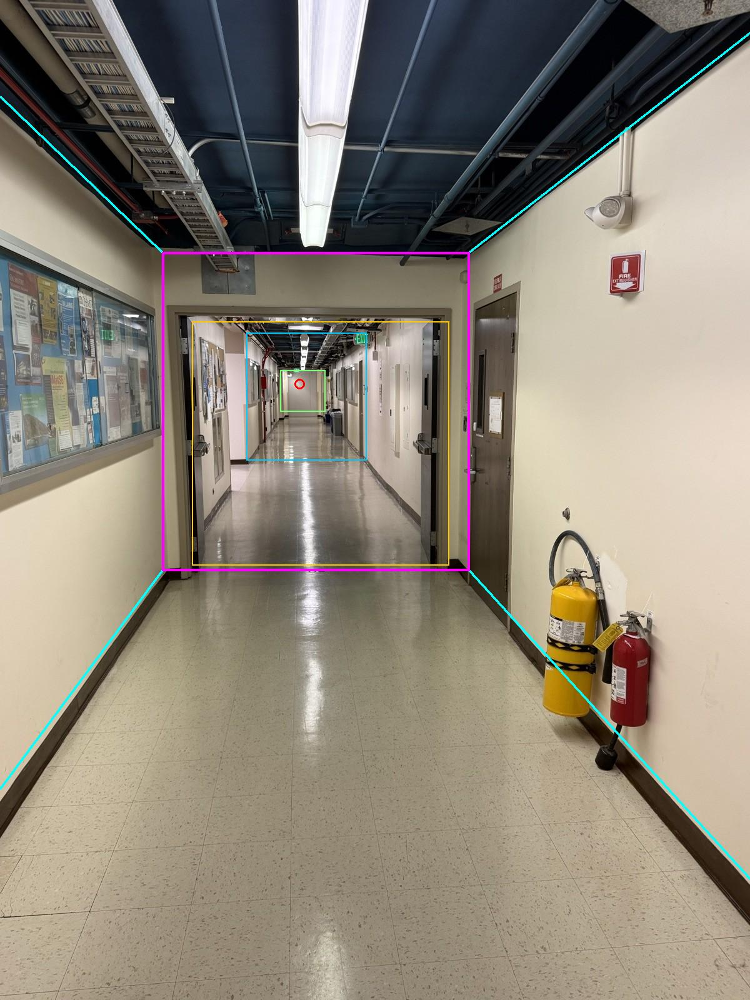
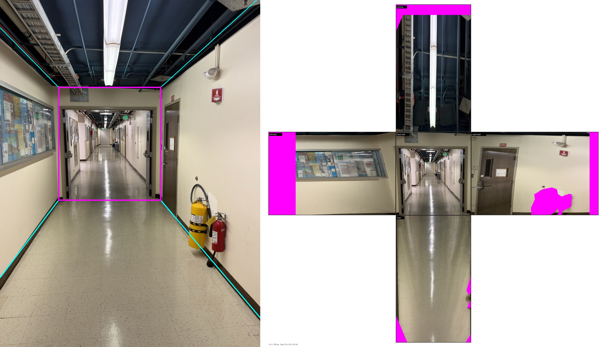
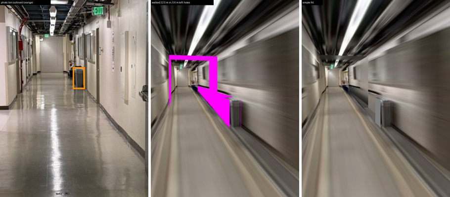
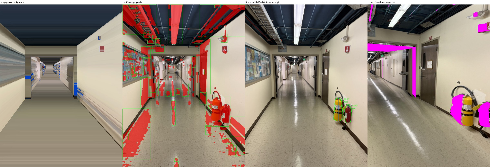
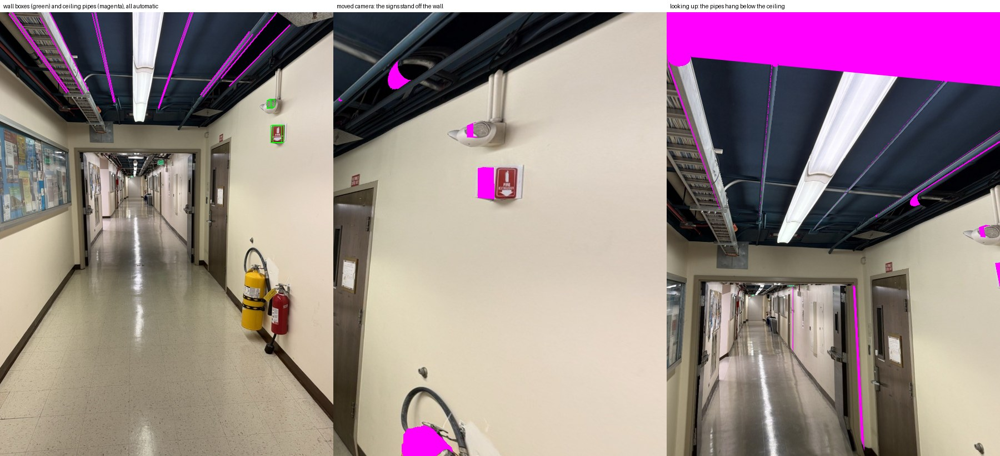
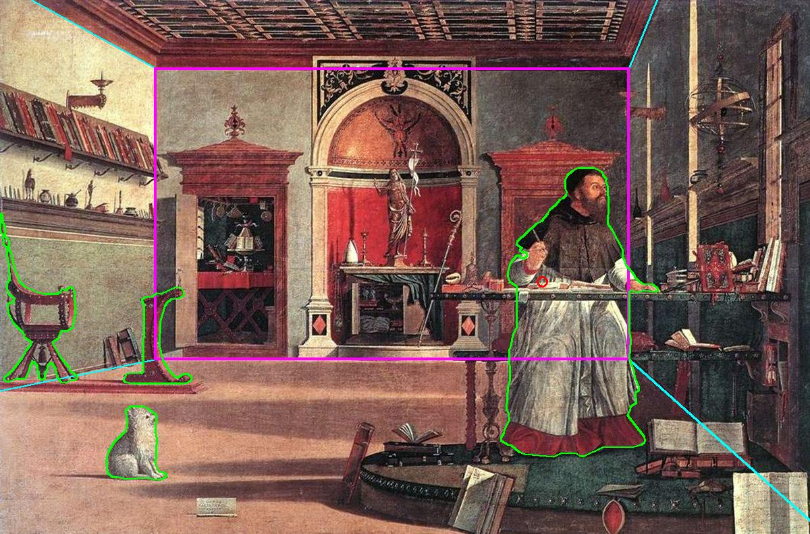
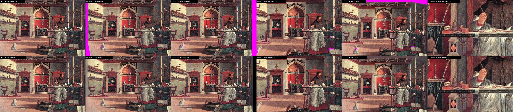

# StepInside

CS180 final project: turn a single interior photograph into a scene you can step into, moving a little sideways or forward and seeing objects shift against the walls behind them.

The starting point is **Tour Into the Picture** (TIP; Horry, Anjyo & Arai, SIGGRAPH 1997). The room is a textured box (back wall, floor, ceiling, left and right walls), and foreground objects are flat cutouts standing at their estimated depth. When the camera moves, it reveals regions the photo never saw. The project's research question is how to fill those: later we will add diffusion inpainting on the rectified wall and floor textures and compare it against inpainting the original photo directly.

**Status:** TIP baseline working on the hallway scene: a chain of 7 boxes runs from the camera through the doorway to the corridor's end wall. Holes are shown, and a simple push-pull fill is available. Automatic annotation detects the vanishing point, the back wall, the deeper boxes down the corridor, room-aligned furniture (cabinets, desks) as 3D boxes, round objects (vases, extinguishers) as 3D surfaces of revolution, boxes fixed to the walls or ceiling (signs, alarm boxes, hanging signs) as thin 3D boxes, and pipes under the ceiling as 3D cylinders. All of it is classical computer vision with no hand input, and it also runs on a Renaissance painting (Carpaccio's *St Augustine*). An interactive editor lets you adjust the result. Diffusion completion is not started.

| Hand annotation (7 boxes) | Automatic annotation (4 boxes) | Novel views (top: holes in magenta, bottom: push-pull fill) |
|---|---|---|
|  |  |  |

Camera sweep with the simple fill: [`outputs/hallway/sweep.gif`](outputs/hallway/sweep.gif)

**Rectified faces.** Each face of the room is perspective-corrected and unfolded at true scale, with holes (no photo data) in magenta. The bulletin board and door become clean rectangles, and the missing regions become simple strips along each face's near edge. That is the case for completing holes in this rectified space rather than in the photo (`python scripts/face_textures.py data/annotations/hallway.json`):



**Room-aligned objects.** Furniture that sits square to the room (cabinets, desks, shelves, beds) is detected automatically and becomes a solid box, not a flat cutout. Moving the camera shows its side and top from a new angle and reveals the floor and wall it hid, as holes (magenta). Shown on a synthetic test room with known geometry. The poster and door are correctly *not* detected (`python scripts/synthetic_demo.py`, then the usual pipeline):


On the hallway photo, the one room-aligned object is the gray trash bin 27 m down the corridor. It's only about 18×39 px and tapered, too small for automatic detection, so it was added in the editor with `o`. Its depth comes from where its bottom meets the floor. Walking down the corridor, it stands out from the wall as a box and uncovers the floor and wall behind it.



**Solids (surfaces of revolution).** Round objects with a vertical axis are found automatically and rebuilt as 3D lathe meshes. On the hallway both fire extinguishers are found, with no false positives and no hand input. The panels show the empty-room background predicted from the room geometry, the regions that differ from it, the traced silhouettes, and a novel view where the extinguishers stand off the wall and uncover holes (`python scripts/solids_figure.py data/annotations/hallway_auto.json`):



**Wall boxes and ceiling pipes.** Things fixed to the walls or ceiling and pipes along the ceiling are also found automatically. On the hallway, the fire-extinguisher sign (10 cm out from the wall, 17 cm tall) and the strobe light (5 cm out) become small boxes standing off the right wall. Six pipes and rails become cylinders hanging just under the ceiling. Flat things (posters, the bulletin board's paper) correctly stay on the wall, since the photo shows no thickness for them. A sideways move shows the sign standing off the wall and the ceiling behind the pipes (`python scripts/wall_things_figure.py data/annotations/hallway_auto.json`):



**Paintings.** The same automatic pipeline runs on Carpaccio's *Saint Augustine in His Study* (c. 1502, public domain) with no hand input. The vanishing point lands on the saint's desk. The back wall is the far wall with the altar niche, not the niche itself, which used to fool the edge-only search. No false corridor boxes are added behind it. The dog, the books and the seal on the floor stand up as small solids. Moving the camera shows the room hold together (`python scripts/annotate.py data/images/st_augustine.jpg --auto-only`, then `scripts/render_views.py`):

| Automatic annotation | Novel views (top: holes in magenta, bottom: push-pull fill) |
|---|---|
|  |  |

## Quick start

**Gallery.** The easiest way to see everything: one local page with every example. For each one you can walk around inside it in 3D, drag a slider between the input and its annotation, click through the novel views (holes or simple fill), and read the figures. `←`/`→` switch examples, `1`–`4` switch views.

```bash
python scripts/serve.py                  # builds site/examples.json, serves the repo, opens http://localhost:8000/site/
```

Any scene in `scenes/` shows up automatically. Titles and descriptions for known examples live in `scripts/build_site.py`.

```bash
pip install -r requirements.txt          # numpy, pillow, matplotlib, opencv-python-headless (GrabCut)

# 1. Build the scene (geometry + per-plane textures) for the viewer
python scripts/build_scene.py data/annotations/hallway.json

# 2. Interactive viewer: serve the repo root, then open the page
python -m http.server 8000
#    -> http://localhost:8000/viewer/?scene=hallway

# 3. Offline renders for figures (novel views, contact sheet, GIF)
python scripts/render_views.py data/annotations/hallway.json
python scripts/face_textures.py data/annotations/hallway.json   # rectified, unfolded faces with holes

# Tests
python tests/test_tip.py                 # geometry + rendering
python tests/test_annotation_tools.py    # auto-annotation (VP, back wall, deeper boxes, objects, solids) + editor, ~2 min
```

**Viewer controls:** drag to move sideways and up/down · scroll or `W`/`S` to walk forward and back (go through the doorway and down the corridor) · `A`/`D` strafe · `Q`/`E` up/down · hold `Shift` to run · `Shift`+drag to look around · `F` toggles the simple fill · `G` toggles the foreground · `H` shows box edges · `Space` wiggles · `R` resets. Holes (no photo data) show in magenta.

## Adding a new scene

```bash
python scripts/annotate.py data/images/my_room.jpg      # auto-detect, then adjust in the editor
python scripts/show_annotation.py data/annotations/my_room.json -o outputs/my_room/annotation.png   # check it
python scripts/build_scene.py data/annotations/my_room.json
python scripts/render_views.py data/annotations/my_room.json    # novel views for the gallery
```

`annotate.py` first **detects the vanishing point, back wall and deeper boxes automatically** ([`tip/auto_annotate.py`](tip/auto_annotate.py)), then opens an editor seeded with the result:

| key / mouse | action |
|---|---|
| drag | move the vanishing point (red) or any box corner (squares) |
| `b` | add a box behind the last one: click its top-left, then bottom-right corner |
| `o` | add a room-aligned object: click its front face's top-left, then bottom-right corner, then drag the orange ◆ back handle to set its depth |
| `f` | outline a foreground object, `Enter` to finish |
| `Backspace` | undo (outline point → foreground object → room object → box) |
| `a` | re-run automatic detection (replaces VP, back wall, boxes and objects) |
| `s` / `q` | save / save and quit (refuses invalid annotations and says why) |

`--auto-only` skips the window and just saves the detection. Passing an existing `.json` reopens it for editing.

**How detection works:**
1. **Vanishing point:** edge pixels vote. Each strong edge pixel defines a line along its edge direction, and the VP is the point most of those lines pass through (coarse grid, then refined). Near horizontal and vertical edges are ignored, since they don't converge in one-point perspective.
2. **Back wall:** an exhaustive search over rectangles around the VP. A rectangle's four corners fix the four room-edge rays (floor/wall and ceiling/wall junctions). Each rectangle is scored by how consistently the image changes across those rays, from each corner out to the border, plus edge strength along its own sides. Running sums keep the 4D search fast.
3. **VP refinement:** the VP is searched jointly with the rectangle. Then each of the four room edges is tracked outward from its back-wall corner (strongest edge across the ray at every pixel), a straight line is RANSAC-fit to the track so clutter like the extinguishers is ignored, and the VP becomes the lines' least-squares intersection.
4. **Deeper boxes, by dynamic programming over where each box ends** (no fixed spacing). A box ending at depth Z_k starts at the previous box's depth Z_{k-1}, so its four floor/ceiling/wall edges run from its far corner out to Z_k/Z_{k-1} times as far from the VP. Its gain is:
   - the edge evidence summed along those four segments,
   - plus the edges of its end rectangle,
   - minus a fixed cost per box.

   Evidence is summed over length, so splitting a uniform corridor gains nothing. Boxes split only where a real boundary (door frame, step, end wall) shows up. Each box must:
   - contain the VP and sit inside the previous box;
   - keep a similar 3D size (at most 30% smaller or 10% bigger, similar proportions), which rules out door panels and posters;
   - end at a visible floor boundary with visible side edges, so a tile grout line isn't mistaken for a box end;
   - be at least 5% deeper and visibly inset on every side. Paper-thin boxes can't be told apart from the edge of an opening.

   Running sums along every corner's ray make each candidate box one lookup, so the whole search takes about 2 s.
5. **Room-aligned objects.** In one-point perspective, a box standing square to the room has:
   - a front face that's an upright rectangle (vertical sides, horizontal top and bottom), with its bottom on the floor below the VP;
   - a visible side (the one facing the VP) and, if it's below eye level, a top, whose edges run toward the VP and stop where the object ends.

   Candidates are pairs of vertical edge runs, with horizontal edges along the top and bottom. Each receding edge is followed toward the VP, counting only edges that run along it. The object ends at the median of where those edges stop.

   This rules out posters and doors on side walls (their top and bottom edges slant toward the VP), pictures on the back wall (nothing recedes), and the room's own openings (they contain the VP). Furniture edges can pose as room edges, so when objects are found, the back wall is searched again with their outlines masked out.

On synthetic rooms with known geometry, the VP is within about 5 px and the back wall within 4 px. On two synthetic corridors, one with even 1.5× steps and one with uneven 1.1× and 2.5× steps, the deeper boxes are within about 5 px. The earlier fixed-1.5×-step version misplaced the uneven case's first box by 45 px and added two fake boxes. On the hallway, the back wall is within 12 px of the hand annotation. Detection finds 2 boxes down the corridor: at the left-wall step (y = 736 vs. 740 by hand) and at the end wall (658 vs. 666). It doesn't split where I did by hand at y = 790, since there's no strong edge there. The VP comes out at (480, 615), where straight lines fit to the four room edges cross (they all meet within about 10 px). My hand-placed VP (492, 628) is about 15 px off. On two furnished synthetic rooms (a cabinet against the wall, a low box, a table straddling the center, and a wardrobe taller than eye level, plus a poster and a door as decoys), all 4 objects are found. Front faces are within 2 px and the back edges within 4 px (about 3% of the object's depth). There are no detections in the empty rooms, the corridors or the hallway. The hallway's only box-shaped object, the trash bin far down the corridor, is below the detector's size limit (it was added by hand, see above). This hasn't been tried on a real photo with furniture yet. Free-form foreground objects (people, plants, the extinguishers) are still outlined by hand in the editor.

You can also write the annotation JSON by hand (see [`data/annotations/hallway.json`](data/annotations/hallway.json)):

| field | meaning |
|---|---|
| `vanishing_point` | `[x, y]` pixel where the room's depth lines converge; must lie inside the back wall |
| `back_wall` | `[x_left, y_top, x_right, y_bottom]` rectangle of the first box's far wall |
| `segments` | optional further boxes, nearest first, each the `[x1, y1, x2, y2]` rectangle of its far end. Each must contain the VP, and its bottom must be closer to the VP than the previous one's |
| `focal_35mm` | 35mm-equivalent focal length (iPhone main camera ≈ 26) |
| `camera_height` | eye height in meters; sets the scene's scale |
| `objects[]` | room-aligned boxes on the floor: `{name, front: [x1, y1, x2, y2], back_y}`. `front` is the front face's rectangle (its bottom is where it meets the floor), and `back_y` is the image row where its far bottom edge meets the floor |
| `foreground[]` | `{name, polygon: [[x, y], ...], contact_y?}`; `contact_y` is the row where the object meets the floor (defaults to the polygon's lowest point) |

Good photos have one-point perspective (looking straight down the room), visible floor/wall/ceiling edges, sharp focus, and few reflective surfaces.

## How it works

1. **Camera.** Pinhole camera at the origin with the vanishing point as the principal point (the classic TIP assumption), so the room's depth axis is the optical axis. Focal length comes from `focal_35mm` (26 mm unless measured, see below).
   - **Finding the vanishing point.** There are up to three candidates. One is a vote by strong edge pixels. Another is a vote by straight line segments (OpenCV's LSD) weighted by length, so a painting's brush strokes, cracks and carpet patterns count for little. The third is the painter's **distance-point construction** run backwards: square tiles laid at 45° have edges converging to two points on the horizon at VP ∓ f. Each tile family alone is a bundle of nearly parallel lines whose meeting point is poorly pinned. So (vx, vy, f) is fitted jointly: the two distance points plus the room's own receding lines at the VP, with segments weighted by length squared (short tile edges near the horizon have biased directions). This also *measures* the focal length instead of assuming one. On a synthetic room with diagonal tiles and a 35 mm lens it recovers the VP to within 1 px and f to within 2%. On Vermeer's *The Music Lesson* it puts the VP on the lady's sleeve, where Vermeer's pinhole has been found, with f ≈ 39 mm. Candidates that explain less than half the long-line evidence of the best one are dropped. Each remaining one is refined jointly with the back wall, without drifting off what the lines say, and the best back-wall fit wins.
2. **Boxes.**
   - **Finding the back wall.** Rectangles around the VP are scored by edge strength along their sides and the four room corners, plus a **surface-split** term. Every room surface except the back wall runs along the depth axis (a wall's paint and baseboard, the floor's boards), so along a ray from the VP the colour barely changes until the ray crosses onto the back wall. Each ray is fitted with two constant pieces split where it meets the rectangle, and the term is the colour variance this split explains, averaged over rays. A rectangle hugging a piece of furniture splits rays where nothing changes and leaves the real room corner inside one piece. In paintings, the corners are soft shading changes and the furniture outlines are crisp, so edges alone pick the furniture; the split term finds the room. The gains are tabulated per ray and side position and summed with cumulative sums, so all ~10⁷ rectangles are still scored exhaustively. Deeper boxes are kept only when they are seen through an opening: a doorway, or a clear band of back wall around the first box. A niche or cupboard that fills the wall is not a corridor.
   - The back-wall rectangle is placed at depth `D`, chosen so the floor sits `camera_height` below the camera. Floor, ceiling and side walls run from the back wall toward the camera, out to where they leave the image ([`tip/geometry.py`](tip/geometry.py)). Each extra `segments` box continues behind the previous one. Automatically, the corridor boxes come from a dynamic program over box ends (`find_deeper_boxes`). It drops boxes thinner than 5% of the depth, so a doorway is found separately (`find_opening`): the largest rectangle in the back wall with a strong lintel edge clearly below the wall's top and jamb edges down to the floor. It becomes a door-frame box 3% of the room's depth deep, so the lintel and jambs are wall faces rather than being smeared onto the corridor ceiling. Its depth comes from its rectangle's bottom edge on the floor, and the previous back wall is split into bands around the opening, so the hallway becomes 7 boxes: room → door frame → 5 corridor stretches → end wall, about 49 m away.
3. **Textures.** For every texel on every plane, we find its 3D point, project it into the photo and sample bilinearly (inverse mapping, so there are no gaps). This removes the perspective distortion: each wall and floor becomes a flat, front-on image, which is where completion will happen. Texels that fall outside the photo, inside a foreground object, or where another plane hides this one in the photo (found with a plane-ID buffer from the input camera) get `alpha = 0`; these are the holes ([`tip/textures.py`](tip/textures.py)).
4. **Objects.** Each room-aligned object becomes a small box (front, sides, top, back) from its floor contact rows. Its faces are ordinary textured planes, so it hides what's behind it in the photo (those texels become holes) and moves with correct parallax.
5. **Solids.** Surfaces of revolution with a vertical axis (vases, bins, extinguishers) are a `solids` entry: a symmetric silhouette, one row per image row. A circle of radius r whose axis lies at horizontal distance D, in direction β, is seen between the rays at β ± α with sin α = r/D. So every silhouette row gives a radius once D is known. D comes from the floor (the lowest point is the near edge of the base) or from the side wall the object hangs on (its outer edge touches the wall). The solid becomes a lathe mesh (`Lathe` in [`tip/geometry.py`](tip/geometry.py); three.js `LatheGeometry` in the viewer). Its front is textured from the photo, and its unseen back is the front mirrored through the silhouette plane. The detector ([`tip/revolve.py`](tip/revolve.py), run by `auto_annotate`) is classical computer vision that builds on the room geometry:
   - **Empty-room background.** Room surfaces are stripes running along the room. A wall's paint and baseboard depend only on height, so each pixel's background is the median of its wall's colours at the same height within ±2 m along the wall. On the floor and ceiling the median runs across the room instead, because a floor object hides a long stretch of floor in depth but only its own width across. The median is taken twice, the second time without the cells the first pass flagged as objects. Near room seams, where the fitted geometry is a few pixels off, a floor pixel must also differ from the in-depth median, which knows where the baseboard is.
   - **Proposals.** Pixels far from that background (Lab distance) are opened and closed. Regions joined by thin bridges (door frames, baseboards) are split with a distance-transform marker growing step.
   - **Tracing.** OpenCV's GrabCut is seeded from each proposal: outlier pixels are "probably object", the rest of the box "probably background". It is a free-form 2D cut, so labels, straps and tags stay inside the object.
   - **Axes.** A mirror-colour symmetry score is computed for each candidate axis: mirrored pixels must both be object and have matching colour. Touching objects of different colours (the yellow and red extinguishers merge into one GrabCut mask) give separate peaks. The width on each row is the nearer side of the mask, so something merged onto one side (the hose, the neighbouring extinguisher) doesn't widen it.
   - **Room checks:** floor or wall mount, plausible real size, fit inside the room, image edges along both sides, sides that end together (a door receding along a side wall has its near side taller at both ends), and at least 16 px wide.
   - **Round vs. flat.** The top and bottom outline must match the projected rim ellipses better than the straight edges of a flat rectangle (horizontal, or receding to the VP). A straight line only counts if it stops at the object's sides; a background line that runs on behind it (the baseboard behind the extinguishers) does not.

   On the hallway (auto or hand room geometry) it finds exactly the two extinguishers in about 12 s at 800 px. On synthetic rooms it finds a floor vase and a wall-hung cylinder to within a few cm, with no false positives from doors, posters or furniture. Without OpenCV, `find_solids(..., proposals="seeds")` is a pure-NumPy fallback: mirrored colour-gradient edge pairs vote for axes, and a GrabCut-style loop with a symmetric-profile Viterbi in place of the graph cut traces them. It works on synthetic rooms, but not on cluttered photos.
6. **Wall boxes and pipes** ([`tip/relief.py`](tip/relief.py), run by `auto_annotate`). Both start from the same empty-room proposals as the solids.
   - **Wall boxes** (`reliefs`). A box fixed to a side wall or the ceiling shows a near face, parallel to the image and so a true rectangle, and a front face parallel to the wall, whose top and bottom edges recede to the VP. The near face's outer edge lies on the wall. A wall at distance W seen p px from the VP is at depth z = f·W/p, so that edge alone fixes the depth. Its inner edge then gives how far the box sticks out, and the front face's far edge gives its length along the wall. One model covers a sign sticking out of the wall (long out, short along), an alarm box (the reverse), and a sign hanging from the ceiling (the same, with the ceiling as the wall). Each proposal is traced with GrabCut and tried against two hypotheses, box and flat, each fitted by coordinate ascent on the IoU between the trace and its silhouette (the convex hull of the projected 3D box). The overlap pins the front corner only loosely, so the corner is then moved to the strongest real edge nearby. A box is kept only if it beats flat: either its silhouette fits clearly better, or the photo shows the near face's own outline (the corner edge, plus top and bottom edges running straight across rather than receding). The contact edge must border the wall it names. On a synthetic room with an alarm box, a wall sign, a hanging sign and a flat poster, the three boxes come back within 3 cm and the poster stays flat.
   - **Pipes** (`tubes`). A pipe along the depth axis has cross-section circles in planes z = const. Each projects to a circle, so the pipe is seen as a wedge between two lines through the VP with sin(half angle) = r/ρ, where ρ is the axis's distance from the optical axis. Touching the ceiling gives ρ, and so r. In a polar resampling about the VP, the pipe's edges are rays of constant angle. Each ray is scored by how much of the ceiling along it has a strong gradient across it. Neighbouring edge rays become a candidate when both edges are supported over the same long stretch and the inside differs in colour from the empty ceiling. It must also be smooth along its length (a cable tray's rungs are not), and edges must bound it on both sides at its full width. That width is measured in four stretches along the pipe, because real pipes drift slightly off the VP. On a synthetic room two pipes come back within 1 cm in position and radius. Pipes become `Cylinder` surfaces (three.js `CylinderGeometry`), with the unseen top mirrored from the visible underside.
7. **Foreground.** Each outlined object becomes a billboard parallel to the image plane. Its depth comes from where its bottom meets the floor. Like classic TIP, billboards draw on top of the box.
8. **Rendering.** [`viewer/index.html`](viewer/index.html) uses three.js, with `setViewOffset` to reproduce the off-center principal point. [`tip/render.py`](tip/render.py) is a NumPy ray-caster that produces the same views for figures and tests. From the original camera it reproduces the input photo (checked in `tests/test_tip.py`).
9. **Simple fill baseline.** `push_pull_fill` fills holes from a weighted image pyramid. It gives smooth color with no texture or line continuation, the "simple filling" baseline from the proposal.

### Hallway scene numbers

`IMG_4484` from project 4, 1200×1600, f ≈ 1156 px. The front room is 2.6 m wide, 2.8 m tall, and spans 1.9–6.2 m in depth. The corridor behind it is about 2.5 m wide out to the end wall at about 49 m. Rendered at half resolution, the share of hole pixels per view is:

| view | holes |
|---|---|
| original | 0.2% (thin ring from the dilated foreground mask) |
| 0.3 m left / right | 11.5% / 13.4% |
| 0.3 m up | 9.9% |
| 1.5 m forward | 3.3% |
| 9 m forward (through the doorway) | 0.6% (but blurry: the far corridor is only a few hundred pixels in the photo) |

## Layout

```
tip/            library: annotations, geometry, textures (+ push-pull fill), renderer, export,
                auto_annotate (VP, back wall, deeper boxes, objects), revolve (solids: surfaces of
                revolution), relief (boxes on walls/ceiling, ceiling pipes), editor (interactive annotation)
scripts/        annotate.py · show_annotation.py · build_scene.py · render_views.py · face_textures.py
                synthetic_demo.py (furnished test room with known geometry) · solids_figure.py · wall_things_figure.py
viewer/         three.js interactive viewer (loads scenes/<name>/scene.json)
data/images/    input photos
data/annotations/  per-scene annotation JSON
scenes/<name>/  built scene: scene.json, <plane>.png (RGBA with holes), <plane>_filled.jpg
outputs/<name>/ rendered figures
tests/          test_tip.py (geometry/rendering) · test_annotation_tools.py (detection on synthetic rooms,
                corridors, furnished rooms + hallway; editor)
```

## Known limitations

- Assumes one-point perspective and box-shaped segments. Alcoves and side doors are flattened onto the walls.
- No lens-distortion correction. On the hallway the room edges are straight to within about 1–2 px (iPhones correct distortion in-camera). Also, radial distortion leaves lines through the image center straight, and TIP's room edges all run through the VP near the center. So even a 15% barrel distortion moves the detected VP by only about 2 px (tested on synthetic rooms). Distortion would only slightly warp wall textures near the photo borders. It would matter for fisheye/GoPro-style lenses or VPs far off-center.
- Foreground objects are flat cutouts. Big sideways moves reveal that they're cards. Only furniture square to the room becomes a 3D box and only upright round objects become solids; a turned chair or an angled desk stays a cutout.
- Solids are upright (no tilt), and a wall-hung solid is assumed to touch the wall. The yellow extinguisher hangs off a bracket and leans; with the auto room geometry the mount test calls it floor-standing, so it sits a few cm off. Small objects (under about 16 px wide at 800 px) are not judged.
- Wall boxes are axis-aligned boxes, so a V-shaped two-sided sign becomes its bounding box. Thickness is only measured where the photo shows it (a near face at least 2 px wide at 800 px); a paper poster or the glass bulletin board, whose near end is out of frame, stays flat on the wall. Objects touching each other in the photo (a sign hanging in front of a pipe) can merge into one proposal and be rejected.
- Pipes must run along the room's depth axis and touch the ceiling; cross pipes (along X) and pipes on hangers stay painted on the ceiling. The light fixture and cable tray are rejected, except that the tray's smooth side rail is taken as a pipe. Pipe widths come out about 20–30% thin on the hallway, where edges are soft at 800 px.
- Object detection needs the front face's outline to be mostly visible (not hidden behind something else). Its depth comes from the receding edges, so a box whose side matches the background in color can come out too shallow.
- The photo has no data close to the camera along the side walls, so even a small sideways step reveals large holes there (see the left/right views).
- The focal length is an assumption (26 mm equivalent) unless the floor shows diagonal tiles (distance points).
- Paintings: Carpaccio's *St Augustine* works end to end. On Vermeer's *Music Lesson* the VP and focal length are right, but the back wall still comes out wrong (about half its true width): the right side of that room is out of frame, and the search only tries rectangles inside the image. In Leonardo's *Last Supper* the table hides the back wall's bottom edge.

## Next steps

- [x] Solids on real photos: OpenCV GrabCut on room-background proposals, wired into `auto_annotate`
- [x] Wall boxes (signs, alarm boxes, hanging signs) and ceiling pipes, automatic and classical
- [x] Back wall on paintings (surface-split term), shown on Carpaccio's *St Augustine*
- [ ] Back walls that run out of frame (Vermeer's *Music Lesson*)
- [ ] Cross pipes along X, door casings as frames, and splitting touching proposals
- [ ] Solids: tilted axes, and SAM as a fallback tracer for shapes GrabCut can't separate
- [ ] Diffusion inpainting on the rectified plane textures vs. on the original photo (the main experiment)
- [ ] Photograph about 6 scenes, plus held-out nearby views for evaluation
- [ ] Hole/seam/line-continuity comparison: unfilled vs. push-pull vs. diffusion
